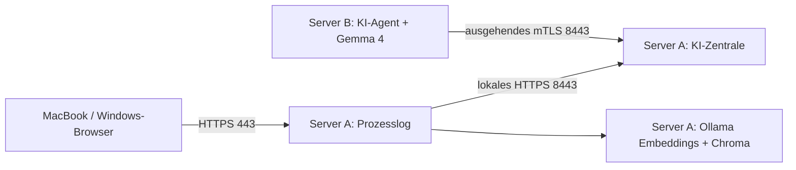

# Zwei Windows-Server: Prozesslog und Zentrale / separater KI-Agent

Vorbereitung vom 5. November 2026. Dieser Plan ersetzt für diesen Test die alten
Ein-Server- und Vier-Server-Aufbauten. Er ist keine Bestätigung laufender Server.

## Grundlage und Aufteilung

Im Chat **„Instanz für Servertest bewerten“** ist der Test vom 3. November
festgehalten: zwei Amazon-Lightsail-Instanzen in Frankfurt, Zone A, Windows Server
2025, jeweils 8 vCPUs, 32 GB RAM, 640 GB SSD, CPU ohne GPU. Beide Instanzen und die
statische IP wurden anschließend gelöscht. Alte IP-Adressen, Schlüssel und
Zertifikate daher nicht als aktuelle Zugänge übernehmen. Der frühere A40-Pod war
ein anderer Versuch und ist nicht die Hardwaregrundlage dieses Plans.

| Rechner | Prozesse | Aufgabe |
| --- | --- | --- |
| Server A | Prozesslog-Web, Worker, Chroma, Ollama mit EmbeddingGemma 2, KI-Zentrale/Gateway, optional Caddy für Prozesslog | Anwendung, Index und Steuerung |
| Server B | KI-Agent aus dieser Anwendung, llama-server, Gemma 4 26B A4B Q4_0 und ggf. passender Vision-Projektor | Ausschließlich generative KI für Text und Bilder |
| MacBook und Windows-Laptop | Browser | Dieselbe Prozesslog-Instanz bedienen |



Der Agent holt Aufträge ab und liefert Antworten an die Zentrale zurück; Server A
muss keine Verbindung zu einem Inferenzport auf B öffnen. Gemma 4 macht Text und
Vision. Ein eventuell separates `mmproj` ist ein Bestandteil dieser Kombination,
kein zweites Bildmodell. Embeddings bleiben als eigener, kleiner Dienst auf A.

Die Trennung verhindert, dass Imports und Indexaufbau auf A gleichzeitig mit dem
Sprachmodell um dieselben CPU-Kerne/RAM konkurrieren. Sie bündelt keinen RAM über
zwei Rechner und beschleunigt B nicht automatisch. Mehr Leistung auf A hilft
Import/OCR/Index; lange Antwortgenerierung wird weiterhin durch B begrenzt.

**32 GB auf B belegen nicht vier Slots mit je 32k Kontext.** Modellgewichte,
KV-Cache, Bildverarbeitung und Windows brauchen zusätzlich Speicher. Zunächst
einen Slot abnehmen, danach vier ausdrücklich konfigurieren und messen. Scheitert
vierfacher Betrieb an RAM oder Zeitbudget, ist die volle Lastabnahme nicht
bestanden; dann B größer dimensionieren. Nicht still den Kontext verkleinern.

## 0. Versionsprüfung vor dem Mieten oder Ausrollen

1. KI-Modul: PR #2 / `feat/prozesslog-gateway-kompatibilitaet` verwenden, vollständigen
   Commit notieren und in GitHub alle Prüfungen für genau diesen Stand abwarten.
   Kein pauschaler Download von `main`: Die Erweiterung ist dort noch nicht gemergt.
2. Prozesslog-Repository ist `abrehmer2000/prozesslog`. Der Default-Zweig
   `v2-berechtigungen-wissensmodell` ist nicht der aktuelle Windows-Teststand.
   Der veröffentlichte Windows-Zweig ist `v3-windows-betrieb`, Stand `741fa50`.
3. Die lokal genannten Prozesslog-Commits `4a25904`, `89f1b93`, `89bc626` auf
   `qualitaet/gateway-navigator-moe` sind am Prüfdatum nicht auf GitHub verfügbar.
   Sie dürfen beim Paketbau nicht fehlen. Auf dem Mac mit diesem lokalen Stand:

   ```sh
   git switch qualitaet/gateway-navigator-moe
   git status --short
   git log -3 --oneline
   git push -u origin qualitaet/gateway-navigator-moe
   ```

   Den Branch danach gegen den Windows-Testzweig vergleichen. Er muss sowohl
   Windows-Installer/Bereitschaftsprüfung als auch Thinking je Aufgabe,
   Gateway-Navigator und Gateway-Bilder enthalten. Keinen Zweig blind ersetzen,
   keinen Force-Push und keine Kunden-/Laufzeitdaten einchecken.
4. Der letzte CI-Lauf des veröffentlichten Windows-Stands ist rot:
   [Lauf 42044900958](https://github.com/abrehmer2000/prozesslog/actions/runs/42044900958).
   5556 Tests bestanden, vier fehlgeschlagen: Chroma-Test mit festem `.venv`-Pfad,
   Betriebs-Eval-Smoke, Lastprobe ohne Vorrang, OCR-Test abhängig von installierter
   Tesseract-Version. Der Abhängigkeitsscan ist grün. Die korrekte kombinierte
   Prozesslog-Testversion muss diese Fehler klären und ihre CI bestehen.
5. Auf der bereitgestellten Prozesslog-Codekopie prüfen (Python, keine Imports,
   keine Datenbank-/Indexzugriffe, keine `.env` gelesen):

   ```powershell
   C:\Prozesslog\.venv\Scripts\python.exe C:\KI-Basis\scripts\two_server_preflight.py --prozesslog-dir C:\Prozesslog
   ```

   `ready: false` hält den vollständigen Test auf. Der Prüfer sucht die relevanten
   Code-Merkmale und Windows-Werkzeuge; er ersetzt weder Tests noch eine
   Funktionsabnahme. Eine bestandene reine Textprobe ist kein Ersatz für fehlende
   Navigator-/Bildfunktionen.

**Stand dieser Vorbereitung:** Die ursprünglichen KI-Modul-Prüfungen waren grün.
Die neue Zwei-Server-Vorbereitung wird zusätzlich geprüft. Die fehlenden lokalen
Prozesslog-Commits können aus dieser Cloud-Arbeitsumgebung nicht veröffentlicht
werden; sie liegen nicht im verfügbaren Git-Objektbestand. Neue Server werden
hier nicht gebucht, gestartet oder eingerichtet.

## 1. Testpakete und Ressourcen

- Zwei neue Windows-Server bereitstellen; neue private Adressen notieren. Die
  historische 8-vCPU-/32-GB-Konfiguration ist die Referenz, kein Leistungsversprechen.
- Windows-AMD64-Paket aus dem erfolgreichen GitHub-Actions-Lauf des gewählten
  KI-Modul-Commits auf beide Server entpacken, z. B. `C:\KI-Basis`. Prüfsummen und
  `BUILD-COMMIT.txt` vergleichen. Das Paket enthält `scripts`, diesen Plan und das
  Gateway-Profil. Python für die optionalen Probeskripte ist auf A ohnehin vorhanden.
- Prozesslog aus der geprüften kombinierten Testversion **ohne Kundendaten**
  bereitstellen. Auf B wird Prozesslog nicht installiert.
- Auf B passende CPU-llama.cpp-Laufzeit, Gewichte und benötigten Vision-Projektor
  bereitstellen; Engine-Version und SHA-256 dokumentieren. Nicht einen CUDA-Build
  für die CPU-only-Referenz verwenden.
- Neues Testverzeichnis und zunächst synthetische/Demodaten verwenden. Zwei Konten
  für Rechteprüfung vorbereiten. Vertrauliche Altbestände erst nach der technischen
  Abnahme und der bereits vereinbarten Datenverarbeitung verwenden.

## 2. Server A: netzwerkfähige Zentrale

In PowerShell im KI-Basis-Verzeichnis (frisches Datenverzeichnis):

```powershell
$centralHost = 'NEUE_PRIVATE_IP_ODER_DNS_VON_A'
.\ki-basis.exe init-central --dir C:\KI-Basis\Zentrale --host $centralHost --listen 0.0.0.0:8443
.\ki-basis.exe serve --config C:\KI-Basis\Zentrale\config.json
```

`init-central` startet keinen Dienst und verändert keine Firewall. Es schreibt
nur in einen neuen Ordner: Konfiguration, Installations-CA, Gateway-Zertifikat
für den angegebenen Host **und 127.0.0.1**, getrennte private Zugänge
`admin-access.json` und `prozesslog-access.json`. Auf Windows erhält der Ordner
eine geschützte vererbte ACL für ausführendes Konto, Administratoren und SYSTEM.
Das Profil enthält 300 s Inferenz und 16 MiB Requests. Keine Modellprozesse auf A.
Eine vorhandene Installation wird nicht überschrieben.

Windows-Firewall und Lightsail-Netzwerkregel: TCP 8443 nur aus dem privaten Netz
bzw. von B und den tatsächlich benötigten Administrationsadressen zulassen.
Prüfen, dass B A unter `$centralHost` erreicht. Keine generelle Öffnung der
Modellports 8081/8082 oder Agent-Oberfläche 3100 erforderlich. Wenn ein Proxy
zwischen B und A steht, muss Geräte-mTLS bis zur Zentrale gelangen; gewöhnliche
HTTP-TLS-Terminierung davor ist für diesen Weg ungeeignet.

In einem zweiten Fenster auf A den lokalen Verwaltungszugang starten:

```powershell
C:\KI-Basis\ki-basis.exe web-preview --listen 127.0.0.1:3000 --backend https://127.0.0.1:8443 --ca C:\KI-Basis\Zentrale\pki\ca.crt --management
```

Im Browser auf A `http://127.0.0.1:3000` öffnen. Mit dem Schlüssel aus
`admin-access.json` und `admin-01` anmelden. Diese lokale HTTP-Strecke verlässt A
nicht; Gateway und Agent verwenden HTTPS. Zugangsdaten nicht in Befehle, Tickets
oder Screenshots kopieren. `pki/ca.key` und `gateway.key` bleiben auf A.

## 3. Server B: nur der KI-Agent

1. In der Zentrale **Server hinzufügen**: neue eindeutige ID, erreichbare
   `https://NEUE_ADRESSE_VON_A:8443`, Modell `gemma-4-26b-a4b`, festgehaltene
   Modell-/Engine-/Projektorrevision. Für die erste Funktionsprobe Kapazität **1**.
2. Die zehn Minuten gültige Verbindungsdatei auf B übertragen und dort
   `Start-Agent.cmd` starten. Im lokalen Browser-Assistenten importieren.
   Dies ist die ausgehende Agentenverbindung deiner Anwendung, kein fremder
   öffentlich freigegebener LLM-Endpunkt.
3. CPU-Laufzeit, Speicherpfad, ggf. vorhandene GGUF-Datei und Projektor samt
   Prüfsumme eintragen. Kontext je Anfrage: **32768**. Genügend freien RAM prüfen.
4. In der Zentrale CPU-Ausführung wählen und **Herunterladen und starten**.
   Erst `bereit` und eine vollständige Testantwort gelten als Erfolg. „Prozess
   läuft“ allein genügt nicht. Engine-Startflags und Vision-Fähigkeit prüfen.
5. Der Adapter startet mit `--jinja`, getrenntem Reasoning, deaktiviertem
   RAM-Promptcache und ohne Kontextverschiebung; die konkrete Engine muss diese
   Flags unterstützen. Kein automatischer Fallback auf eine andere Modellkombination.

Auf B bleiben Agent und Modell zunächst sichtbar aktiv. Nicht zusätzlich einen
manuellen llama-server starten. Abmelden vom RDP/Windows-Neustart sind eigene
spätere Prüfschritte; ein geöffnetes Fenster ist kein Systemdienstnachweis.

## 4. Server A: Prozesslog und lokale Suche

Die Anleitung im **Windows-Zweig** von Prozesslog verwenden:
[Windows-Einrichtung](https://github.com/abrehmer2000/prozesslog/blob/v3-windows-betrieb/docs/betrieb/WINDOWS.md).
Python 3.14 x64 und Ollama für Windows vorbereiten; der frühere Test verwendete
Python 3.14.10. Den gelieferten Installer auf der geprüften kombinierten Codekopie
als Administrator ausführen:

```powershell
powershell -ExecutionPolicy Bypass -File .\deploy\windows\installieren.ps1 -Ordner C:\Prozesslog
```

Er muss Web, Worker **und Chroma** einrichten. Ollama für die Embeddings läuft
separat auf A. `embeddinggemma-2` mit dem vorhandenen vorgesehenen Indexraum
verwenden; bei Modellwechsel einen frischen Index bzw. vollständigen Neuaufbau
planen. Kein großes generatives Ollama-Modell auf A für diesen Aufbau laden.

In `.env` bzw. Verwaltung → KI die folgenden Werte abstimmen. Gespeicherte
Oberflächenwerte können `.env` übersteuern; nicht zwei widersprüchliche aktive
Konfigurationen behalten.

| Einstellung | Testwert |
| --- | --- |
| `LLM_PROVIDER` | `openai` |
| `PROZESSLOG_CLOUD_ERLAUBT` | `1` |
| `OPENAI_BASE_URL` | `https://127.0.0.1:8443/v1` auf A |
| `OPENAI_API_KEY` | **Anwendungszugang** aus `prozesslog-access.json`, kein Admin-Key |
| `OPENAI_USER_ID` | `prozesslog-test` |
| `OPENAI_MODEL` | `gemma-4-26b-a4b` |
| `OPENAI_CA_BUNDLE` | `C:\KI-Basis\Zentrale\pki\ca.crt` |
| `OPENAI_JSON_MODE` | zunächst `json_object`, nach Schema-Probe `json_schema` |
| `OPENAI_DENKEN` | `aufgabe`, nur mit vorhandenem Gateway-Commit |
| `OPENAI_VERSUCHE` | `1` für die Diagnose; danach bewusst festlegen |
| `RAG_NAVIGATOR_GATEWAY`, `OPENAI_BILDER` | `1`, nur mit vorhandenem Gateway-Commit |
| `RAG_NAVIGATOR_BUDGET_SECONDS` | `300` für die dokumentierte CPU-Qualitätsprobe |
| `RAG_NAVIGATOR_THINK` | zuerst `0`, danach getrennte Probe mit `1` |
| `VISION_TIMEOUT` | `300` für den CPU-Bildtest |
| `WISSEN_PLANER` | `aus` (Nachtprüfung bleibt aus) |
| `OLLAMA_URL` | `http://127.0.0.1:11434` |
| `EMBED_BACKEND`, `EMBED_MODEL` | `ollama`, `embeddinggemma-2` |
| `RAG_CHROMA_URL` | `http://127.0.0.1:8100` |

Wichtig: Die Prozesslog-Zeitgrenzen sind aufgabenspezifisch. Das 300-s-Gateway
hebt einen kürzeren Client-Aufruf nicht auf. Import-/Chat-/Navigator-Aufruf und
Gesamtbudget im tatsächlichen Teststand prüfen; sechs Aufrufe müssen in das
Navigator-Gesamtbudget passen. Nicht unbegrenzt wiederholen, um Überlast zu verdecken.

## 5. Funktionstest: erst ein Slot, dann vier

Jede Phase endet bei einem Fehler. Messwerte sind zunächst Beobachtungen; falsche
Antworten, verlorene Inhalte, Rechteverletzungen, abgeschnittene Antworten und
fehlende Funktionen sind Fehler unabhängig von ihrer Dauer.

| Phase | Handlung | Bestehenskriterium |
| --- | --- | --- |
| A | `two_server_preflight.py` auf Prozesslog-Code | Alle Merkmale vorhanden; richtige Versionskombination |
| B | Prozesslog `tools\bereit_pruefen.py` | Web, Worker, Chroma, Embeddings und Gateway bereit |
| C | Mit einem Slot Gateway-Smoke auf A | Text, Thinking, Objekt, Schema, Bild und langer Kontext erfolgreich |
| D | Kleines bekanntes PDF/Word-Dokument mit Bildern importieren | Auftrag vollständig fertig; Text, Bilder und Beschreibung vorhanden; kein Verlust bei kontrolliert abgelehntem Bild |
| E | Bekannte Frage, dann „Gründlich nachsehen“ | Richtige Fakten, passende klickbare Belege, nachvollziehbare Fehlermeldung statt erfundener Antwort |
| F | Dokumentierte Maschinenfotos aus dem früheren Test | Zuordnung über Dokumentation/Dateinamen; weiteres Perspektivfoto getrennt zurückhalten und danach suchen; negatives Fremdfoto korrekt behandeln |
| G | Zweite Rolle ohne Freigabe, zusätzlich sichtbare Kontrollquelle | Gesperrter Inhalt fehlt in Antwort/Belegen; freigegebene Kontrollquelle bleibt sichtbar |
| H | KI-Kapazität 4 und 32768 Kontext je Slot | Wirklich vier Slots, Gesamtkontext 131072; kein OOM/Paging-Sturm, keine still verkleinerten Slots |
| I | Vier parallele Anfragen, dann paralleler Import + Chat + Navigator | Vollständige Antworten, korrekte Zuordnung, begrenzte Überlast mit Retry-After; CPU/RAM und Zeiten dokumentiert |
| J | Agent/Engine stoppen und erneut starten | Verständlicher Ausfall, keine Verlust-/Doppelverarbeitung, Wiederanlauf mit derselben gültigen Identität |
| K | Zentrale neu starten, später beide Server nach eingerichteten Startmechanismen | Agent meldet sich wieder; Web, Worker, Chroma, Ollama und Zentrale kommen unabhängig von Laptop/RDP zurück |
| L | MacBook und Windows-Laptop gleichzeitig | Dieselbe HTTPS-Prozesslog-Adresse, gültige Zertifikate, Anmeldung und gleiche Datenbasis |

Auf A, im KI-Basis-Ordner (ein Slot):

```powershell
C:\Prozesslog\.venv\Scripts\python.exe scripts\prozesslog_smoke.py --access-file C:\KI-Basis\Zentrale\prozesslog-access.json --base https://127.0.0.1:8443/v1 --model gemma-4-26b-a4b --parallel 1 --report C:\KI-Basis\probe-ein-slot.json
```

Für vier Slots muss die in der Agent-Identität hinterlegte Kapazität passen.
Nicht bloß `--parallel 4` am Testprogramm setzen. Bei vorhandener Kapazität 1
über den regulären Anmeldeablauf einen neuen Knoten mit Kapazität 4 erstellen,
alten Knoten nach erfolgreicher Umstellung widerrufen und keine zwei Modellprozesse
konkurrierend starten. Danach denselben Smoke mit `--parallel 4` und neuem Bericht
laufen lassen. Der parallele Smoke startet vier kleine Requests zeitgleich; für
den RAM-/Kontextnachweis zusätzlich vier lange Anfragen gleichzeitig senden.

Im Prozesslog-Ordner, nachdem die erforderlichen Commits tatsächlich vorhanden sind:

```powershell
.\.venv\Scripts\python.exe tools\gateway_pruefen.py --denken --bild --parallel 4
.\.venv\Scripts\python.exe tools\last_pruefen.py --bericht C:\KI-Basis\prozesslog-last.md
```

Rot oder Gelb vor dem nächsten Abschnitt beheben. Das Lastwerkzeug stammt aus
Prozesslog und wurde ursprünglich für lokale Modellzulassung gebaut; seine
Gateway-Aussagekraft im gewählten Commit prüfen. Zusätzlich die echten
Anwendungsaktionen in Phase I messen; ein isolierter CLI-Erfolg genügt nicht.

## 6. Zugriff vom Arbeitsplatz und Neustart

Zunächst lokal auf A per RDP testen. Danach den vorhandenen Prozesslog-HTTPS-
Assistenten aus dem Windows-Zweig einsetzen, Caddy vor **Prozesslog** konfigurieren,
Port 443 nur für die Testarbeitsplätze/VPN freigeben und die dort erzeugte
Prozesslog-CA auf Mac/Windows vertrauenswürdig hinterlegen. Diese CA ist nicht
automatisch dieselbe wie die KI-Zentralen-CA. Keine öffentlichen Ports für
Chroma, Ollama oder die Agent-Oberfläche öffnen.

Prozesslog `deploy\windows\dienste.ps1 -Aktion status` und anschließend die
Bereitschaftsprüfung verwenden. Für Zentrale und Agent den Windows-Startmechanismus
explizit einrichten und unter dem vorgesehenen Konto testen. Der vorhandene
Agent-Autostart bei Benutzeranmeldung belegt noch keinen unbeaufsichtigten
Serverneustart. Bis Phase K bestanden ist, bleibt der Aufbau ein begleiteter Test.

## 7. Protokoll und Rückweg

Je Durchlauf festhalten: beide vollständigen Git-Commits/Build-Prüfsummen,
Engine-/Modell-/Projektorversion, RAM/vCPU, tatsächlich konfigurierte Slots und
Kontext, Peak-RAM/Commit/Paging auf B, parallele Auslastung auf A, Zahl der
Modellaufrufe, Dauer für Import/Chat/Navigator/Bild, Fehlercode und Request-ID.
Erste Anfrage und warmen Betrieb getrennt erfassen. Antworten fachlich anhand
der bekannten Quellen bewerten. Keine Schlüssel oder Kundeninhalte ins Git.

Bei Fehlern zuerst feste Testversion und Diagnose sichern, dann stoppen.
Bestehende Sicherungen nie durch mehrere gleichzeitig aktive Restaurierungen
gegen dieselbe Geräteidentität testen. Vorheriges Binary plus passende
Konfiguration wiederherstellen; keine ungetesteten Datenbank-Downgrades.
Neue Server erst nach gesicherter Datensicherung löschen; Lightsail-IP, Snapshots
und Zusatzdatenträger separat prüfen, wie im früheren Test bereits durchgeführt.

**Freigabe:** Erst wenn Versionsgate, fachlicher Ablauf und der gewünschte
Parallelbetrieb auf den zwei echten Rechnern bestanden sind, ist dieser Test
abgenommen. Ein Merge allein oder grüne simulierte Tests sind dafür kein Nachweis.
